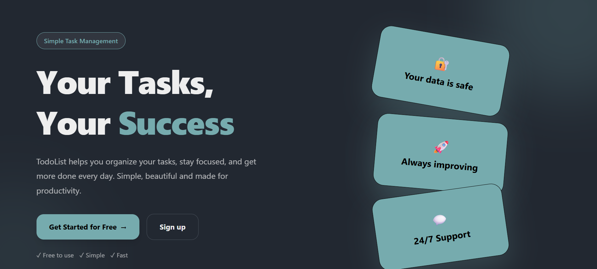

# Smart Planner

Smart Planner is a simple task planning app that helps users organize their daily tasks and manage their time. I built this project to practice my frontend development skills and improve my experience with React.

## Features

- Organize daily tasks
- Plan and manage schedules
- Simple and clean user interface
- Easy-to-use design

## Screenshot

<!-- Add your project screenshot here -->

## Technologies Used

- React
- Vite
- Tailwind CSS

## Live Demo

Check out the live version here:👇

[Smart Planner](https://smart-planner-p4dk.vercel.app/)